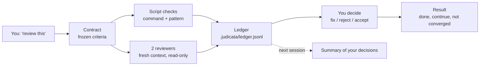

# judicata

**Make AI reviews converge.** Decide once what "done" means, and every chat, every agent and
every new session judges your work against the same yardstick and remembers what you already
settled.

*Res judicata*: what has been decided is not argued again.

Works in **Claude Code** and the **Codex CLI** as a plugin, and in other agents (OpenCode,
Cursor and more) as plain Agent Skills. Pure Python 3.11+, nothing else to install. MIT
licensed.

## Installation (30 seconds)

<details open>
<summary><strong>Claude Code</strong></summary>

```
/plugin marketplace add philippmelikidis/judicata
/plugin install judicata@judicata
```

To update later: `/plugin marketplace update judicata`.

</details>

<details>
<summary><strong>Codex CLI</strong></summary>

```bash
codex plugin marketplace add philippmelikidis/judicata
codex plugin add judicata@judicata
```

Then trust the hooks once: start `codex`, open `/hooks` and trust the SessionStart and Stop
hooks of judicata. Codex skips untrusted plugin hooks silently, and without them a new session
does not know your earlier decisions and the stop gate does not warn. Differences to Claude Code: [reference](docs/reference.md#codex).

</details>

<details>
<summary><strong>Any other agent</strong> (OpenCode, Cursor, Gemini CLI, Copilot, ...)</summary>

```bash
npx skills@latest add philippmelikidis/judicata --skill '*' -a <agent>  # opencode, cursor, ...; omit -a to choose
```

[skills.sh](https://skills.sh) copies the three skills `review`, `contract` and `status`
into your project (`-g` for all projects). Install all three: the review skill ships the
core, the other two use it. To update, run `npx skills@latest update`. In Claude Code and
Codex take the plugin instead, never both, or you get every skill twice. What a plain
install lacks: see the table below and [Other agents](docs/reference.md#other-agents-plain-skills).

</details>

Requirement: `python3` (3.11 or newer) on your `PATH`.

What each install gets:

| | Claude Code plugin | Codex plugin | Plain skills (other agents) |
| --- | --- | --- | --- |
| Summary of your decisions in every new session (hook) | yes | yes, once you trusted the hook | no: the review and status skills read it themselves when they run, and say so |
| Stop gate: a one-line warning when a turn ends with open blockers or unreviewed changes ([details](docs/reference.md#stop-gate)) | yes | yes, once you trusted the hook | no (no hooks) |
| Independent reviewers in a fresh context | sub-agents with read-only tools | sub-agents, read-only by instruction | the agent's sub-agents, read-only by instruction; without sub-agents one reviewer, the session itself, and the report says so |
| Questions | answer buttons | numbered list | the agent's question tool, or a numbered list |
| Skills | `/judicata:review`, `/judicata:contract`, `/judicata:status` | `judicata:review`, ... | `review`, `contract`, `status` |

## Your first review

Open a project and say what you want, in plain words:

```
> review this
```

or run `/judicata:review`. The first time, judicata interviews you for a **contract**: it picks
a template (code, docs or prose), proposes criteria from it and from your project (for example
the test command it finds), and you keep, drop or add criteria and mark them required or
optional. Most answers are one Enter. Then it reviews:

```
judicata: Reviewing src/ (12 files) against contract "code", all criteria.

  CODE-1  Tests pass                  passed   (pytest -q, exit 0)
  CODE-2  Linter is clean             passed
  CODE-3  No known correctness bugs   FAILED   both reviewers agree
          src/ledger.py > Ledger.append
          "two writers can append the same event id; the second replay drops it"

  1 blocker, 0 should-fix, 2 notes.   Result: continue (round 1 of 5)

  Decide: [Fix]  [Reject, with reason]  [Accept the risk, with reason]
```

You fix it (judicata itself never edits your files), say "review this again", and round 2 confirms the
fix. Tomorrow, in a fresh chat, judicata still knows that you rejected the note about naming
and does not bring it up again, unless that code changes.

*(Illustration. The real report depends on your contract.)*

## Why judicata

### 1. Every chat says something different

Ask two chats to review the same file and you get two lists. A third chat finds something new.
No reviewer ever says "this is done", because nothing defines done.

**The fix: a contract, decided up front.** A short file in `.judicata/contracts/` lists the
criteria, each required or optional, each with a fixed check:

| Check | Example | Who decides |
| --- | --- | --- |
| **command** | "Tests pass": `pytest -q` exits 0 | a script, same result every time |
| **pattern** | "At most 400 words", "no em dashes" | a script, same result every time |
| **judgment** | "Every claim has a source" | two independent reviewers; if they disagree, you decide once |

After the interview the contract is frozen. It changes only when you ask
(`/judicata:contract`), with a visible diff and a new version. No agent quietly moves the
goalposts.

### 2. Settled points keep coming back

You explained why a finding is not a problem. The next session suggests the same "fix" again.

**The fix: a ledger in your repository.** Every round, finding and decision is appended to
`.judicata/ledger.jsonl`. Findings are tied to an address that survives moved lines (class and
function in Python, heading and paragraph in Markdown), so judicata recognizes the same point
next week. A finding you rejected stays rejected at that place; if the place changes, it comes
back once with your old reason. A new session starts with a short summary of the ledger. The
ledger is committed with your work and merges across branches without conflicts, so your team
shares it.

### 3. Reviews never end, or end too early

Some loops find a new nit forever. Others call it "done" while a required check still fails.

**The fix: an honest stop rule.** After every round judicata tells you where you stand:

| Result | Meaning |
| --- | --- |
| **done** | every required criterion passed, no confirmed blocker is open |
| **done with accepted risks** | done, but you accepted or rejected blocker or should-fix findings (optional criteria or outside the contract); they are listed |
| **required criteria not met** | you decided a failed required criterion away; judicata asks whether you really want to finish ("No, keep it open" comes first) |
| **finished despite unmet required criteria** | you said yes; shown permanently, with your reasons |
| **not converged** | two rounds in a row without fewer open blockers |
| **round limit reached** | 5 rounds by default; both limits are set in the contract |

## How it works



- **Reviewers** run in parallel, each with a fresh context and only read tools, by default on
  the model of your chat. They do not see each other. With two reviewers, a finding counts when both
  report it, and a blocker only one of them sees is shown to you as unconfirmed. With one
  reviewer (your choice, or a contract without judgment criteria), its findings count directly. Want something else? Say "only
  one reviewer" or "use Opus and Sonnet".
- **Blockers need evidence.** Outside the contract, only a correctness, security or factual
  finding with a concrete scenario can block. Everything else is at most a note.
- **The core is a plain Python command line.** Skills and hooks only call it, so the same rules
  apply in every host and every session.

## Commands

You rarely need them; plain words work. In a project with `.judicata/`, judicata starts on its
own when you ask for a review.

| Say | Or run | Does |
| --- | --- | --- |
| "review this", "is the cover letter done?", "check the software for bugs", "review my changes against main", "look at the ledger module" | `/judicata:review` | reviews the scope you named, with the focus you named |
| "show the contract", "make CODE-4 optional" | `/judicata:contract` | shows or changes the contract (diff first, then you confirm) |
| "where do we stand?" | `/judicata:status` | every contract at a glance: result, blockers, accepted risks, rounds |

## Templates

The interview starts from one of three templates. You can change every criterion.

- **code**: tests pass, linter clean, no known correctness bugs, ticket criteria met (optional)
- **docs**: steps can be followed as written, every command and path exists, the audience is clear
- **prose** (cover letters, thesis chapters, articles): claims backed or marked as your own, at
  most 400 words, no em or en dashes, your voice is kept

Several contracts per repository are fine, for example `code` for `src/**` and `prose` for
`thesis/*.md`.

## FAQ

<details>
<summary><strong>Does judicata change my code?</strong></summary>

Not by itself. It reviews and records. "Fix" marks a finding as resolved; you make the change,
and the next round confirms it. judicata writes only `.judicata/` and one line in
`.gitattributes` (`.judicata/ledger.jsonl merge=union`). Commit both. The commands in your
contract run as written, so use checks that do not modify files (`ruff check`, not
`ruff check --fix`).

</details>

<details>
<summary><strong>Do I need Git?</strong></summary>

No. With Git, every round records the commit and a hash of the files; without Git, just the
hash. With Git, the ledgers of two branches merge without conflicts. Contract files are normal
files: if two branches change the same contract, Git asks you to resolve it as usual.

</details>

<details>
<summary><strong>What does a review cost?</strong></summary>

Command and pattern criteria need no model: a script runs them. The review itself runs in your
chat (it calls the core and reports the result), plus one sub-agent per reviewer on your chat's
model, two by default. A contract with only command and pattern criteria still plans one
reviewer, for findings outside the contract.

</details>

<details>
<summary><strong>Does it replace /code-review or CI?</strong></summary>

No. CI runs your tests, and judicata can run them as a criterion. `/code-review` and similar
tools find issues; judicata adds the yardstick, the memory and the stop rule around a review,
for code and for text.

</details>

<details>
<summary><strong>Can I use it on a repository I do not trust?</strong></summary>

Carefully. A contract's commands run only after you approved them on your machine; nothing
checked in can approve them. Text from the ledger and the contract is treated as data, cleaned
and checked for prompt injection, and judicata asks you before acting on anything that reads
like an instruction. That is a heuristic, not a guarantee. Details:
[Security](docs/reference.md#security).

</details>

## Security in short

- Commands from a contract you did not write run only after your approval, which is stored
  outside the repository.
- Text from `.judicata/` is data, never an instruction. Suspicious entries are marked
  ("possible prompt injection detected in entry ..."), and judicata asks before doing anything
  they ask for.
- In Codex and as plain skills, reviewers are read-only by instruction, not by a hard tool
  limit.
- Review changes to `.judicata/` in a pull request like code.

Full details and limits: [docs/reference.md](docs/reference.md#security).

## What judicata runs, stores and sends

- **Runs:** the Python core (`scripts/judicata.py`, standard library only, no packages
  installed), the commands of your contract after your approval, a SessionStart hook that prints
  a summary of the ledger, a Stop hook that warns when work under a contract is not reviewed
  and done, and reviewer sub-agents on your chat's model with read-only tools.
- **Stores:** `.judicata/` (contracts and ledger) and one line in `.gitattributes` in your
  project, and command approvals plus the start time of each session (for the stop gate) in
  the plugin's data directory (or `~/.local/state/judicata`).
- **Sends:** nothing. judicata makes no network requests and collects no data. Your agent's
  model sees the files under review, as with any review.

## Reference

[docs/reference.md](docs/reference.md) covers the contract format, the three checks, findings
and addresses, decisions, the stop rule, scope and focus from plain language, Codex, other
agents, security and how to run the tests and evals.

## Development

```
uvx ruff@0.17.1 check . && uvx ruff@0.17.1 format --check .
uv run --with pytest==9.1.1 pytest
claude plugin eval . --scaffold --allow-tools Bash --trust-plugin --runs 1 --no-publish
```

The tests drive the core command line. `skills/review/core/` is a generated copy of the
core for plain skill installs: rebuild it with `python3 tools/bundle_core.py`, CI fails while
it differs from the source. Every change to shipped files (manifest, skills, agents, hooks,
scripts, templates) needs an entry under `## [Unreleased]` in [CHANGELOG.md](CHANGELOG.md) or a
higher version in `.claude-plugin/plugin.json`; `python3 tools/check_version.py` checks this in
CI. To release: raise the version, move the Unreleased entries under it, tag `v<version>`.
Five acceptance evals in `evals/` check the plugin's
behavior in Claude Code against a baseline without the plugin. See
[Development](docs/reference.md#development).

## License

MIT, see [LICENSE](LICENSE).
